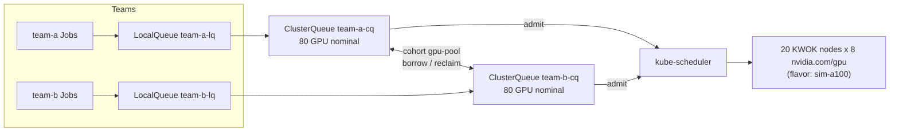
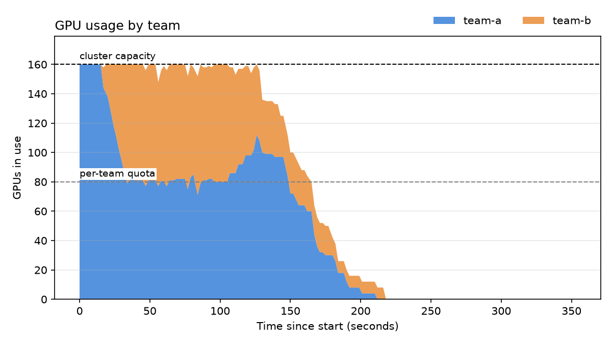
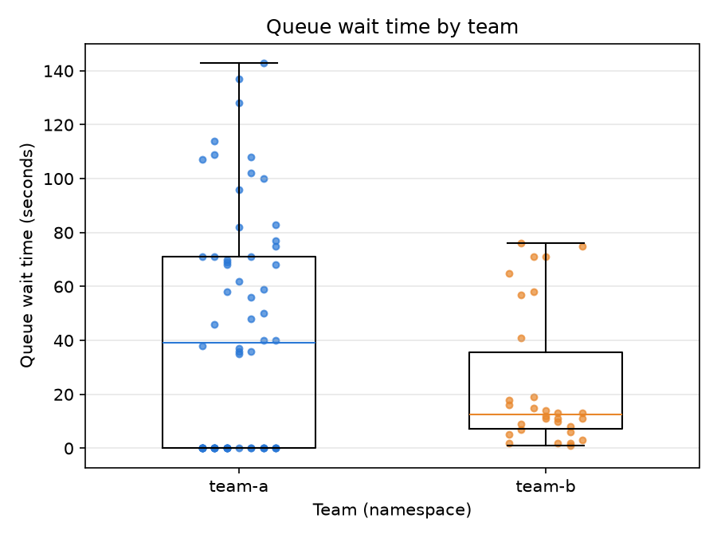

# Mini GPU Scheduler on Kubernetes

A laptop-sized model of a multi-team GPU platform: **160 simulated GPUs, two teams, quota guarantees, borrowing, and preemption**, built with kind, KWOK, and Kueue. No real GPUs required.

> Status: GPU quota scheduling (Kueue) complete. Model serving + HPA autoscaling and distributed training in progress.

## Why

Large GPU clusters are shared by many teams. Two goals pull against each other:

- **Guarantees:** each team should get its fair share when it needs it.
- **Utilization:** GPUs are expensive, so idle capacity shouldn't sit unused.

This project reproduces that trade-off locally and measures how Kueue's quota + borrowing + preemption model handles it.

## Architecture



- **kind** runs a real Kubernetes cluster in Docker (1 control-plane + 2 workers).
- **KWOK** adds 20 fake nodes, each advertising `nvidia.com/gpu: 8`, tainted so only GPU workloads land there. Fake pods get configurable runtimes via a KWOK Stage delay.
- **Kueue** decides *when* a job may run (quota admission); the default scheduler decides *where*.

| Concept | Config |
|---|---|
| Quota per team | `nominalQuota: 80` GPUs |
| Borrowing | Both queues in cohort `gpu-pool`, `borrowingLimit: 80` |
| Reclaim | `preemption.reclaimWithinCohort: Any` (evict borrowers to restore guarantees) |
| Ordering | `BestEffortFIFO` |
| Placement | `ResourceFlavor` injects node labels + tolerations at admission |

## Results

Experiment: team A submits 60 jobs; team B submits 30 jobs 15 s later. Job sizes 1/2/4/8 GPUs, runtimes 30–90 s.



- Team A borrowed the idle half of the cluster (**160/160 GPUs**) while team B was idle.
- When team B arrived, Kueue preempted team A's borrowed jobs and both teams settled at their **80-GPU guarantees within ~20 s**.
- When team B's queue drained, team A **borrowed again**. The cluster stayed near 160/160 the entire time both teams had work.



- Median queue wait: **team A ~39 s, team B ~12 s**. Team B arrived later but its guarantee let it reclaim capacity immediately.
- Team B never waited 0 s: every admission required evicting a borrowed job first, so its minimum wait approximates **reclaim latency**.
- *Caveat:* wait is measured to a workload's latest admission, so preempted-and-requeued jobs inflate team A's tail.

Full notes: [`docs/experiments/findings.md`](docs/experiments/findings.md)

## Quickstart

Requires Docker Desktop (≥4 CPUs, ≥8 GB RAM), `kind`, `kubectl`, `jq`, `uv`.

| Target | What it does |
|---|---|
| `make cluster-up` | Create the kind cluster |
| `make kwok-install` | Install the KWOK controller |
| `make kwok-runtime` | Give fake pods configurable runtimes |
| `make gpu-nodes-up` | Add 20 fake nodes x 8 GPUs |
| `make gpus` | Verify 160 GPUs |
| `make kueue-install` | Install the Kueue controller |
| `make queues-up` | Create flavor, ClusterQueues, LocalQueues, namespaces |

```bash
make cluster-up kwok-install kwok-runtime gpu-nodes-up kueue-install queues-up
make gpus
```

Run the experiment. Start `make watch` in a second terminal first; it shows live queue state and records GPU usage.

```bash
scripts/submit-jobs.sh team-a 60
sleep 15
scripts/submit-jobs.sh team-b 30
```

After all jobs finish, `make waits` writes `docs/img/queue_wait_times.png`, `make usage-chart` writes `docs/img/gpu_usage.png`, and `make clean-jobs` removes the jobs.

## Repo layout

```
cluster/   kind config, KWOK node template, KWOK stage delay patch
kueue/     ResourceFlavor, ClusterQueues, LocalQueues, job template
scripts/   node generator, job submitter, live queue watcher, chart scripts
docs/      charts (img/) and experiment notes
serving/   model server + HPA            (in progress)
loadtest/  Locust load tests             (in progress)
training/  PyTorch DDP on CPU (gloo)     (planned)
```

## Lessons learned

- **Quota ≠ capacity.** A 9-GPU pod stays Pending on a cluster with 160 free GPUs because no single node has 9. Fragmentation is a scheduling problem quota can't solve; team B similarly stalled at 79/80 when its remaining jobs didn't fit the last free GPU.
- **Preemption trades work for fairness.** Reclaimed jobs are requeued, not lost, but their progress is, which is why real training platforms pair preemption with checkpointing.
- **Reclaim isn't instant.** Eviction → pod termination → quota release took a few seconds, briefly letting the borrower hold capacity the owner was waiting for.
- **Pin and verify API versions.** Kueue v0.20 serves only `v1beta2` (and renamed `cohort` → `cohortName`); manifests written for `v1beta1` silently left jobs unadmitted. Check `kubectl api-resources` after installing any operator.
- **Simulators need tuning to be realistic.** KWOK's default stages complete Job pods instantly, so nothing ever queued until I added a per-pod runtime via a Stage delay annotation.

## Stack

Kubernetes v1.37 (kind) · KWOK v0.8.0 · Kueue v0.20.7 · Python (uv, pandas, matplotlib)
